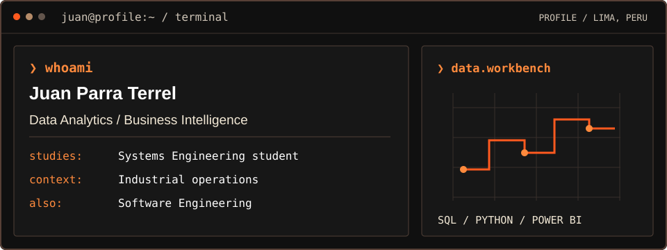
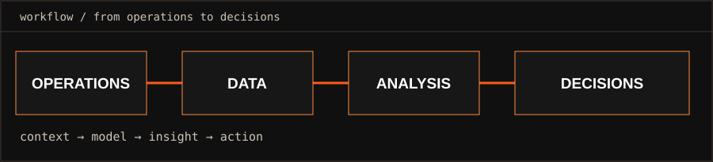
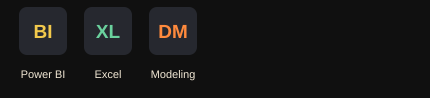
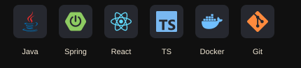
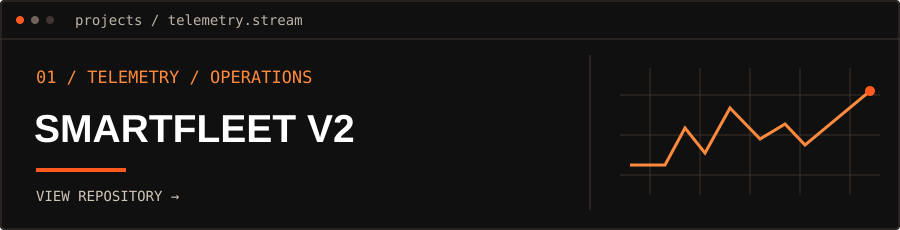
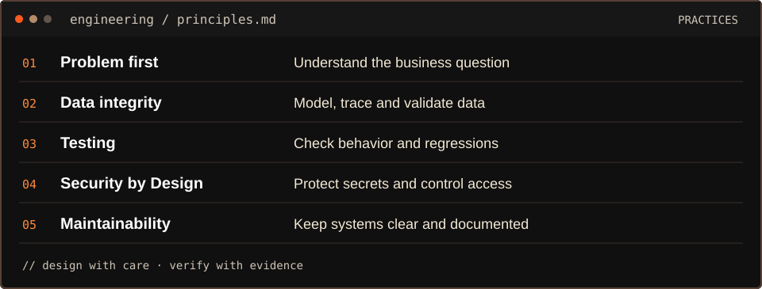
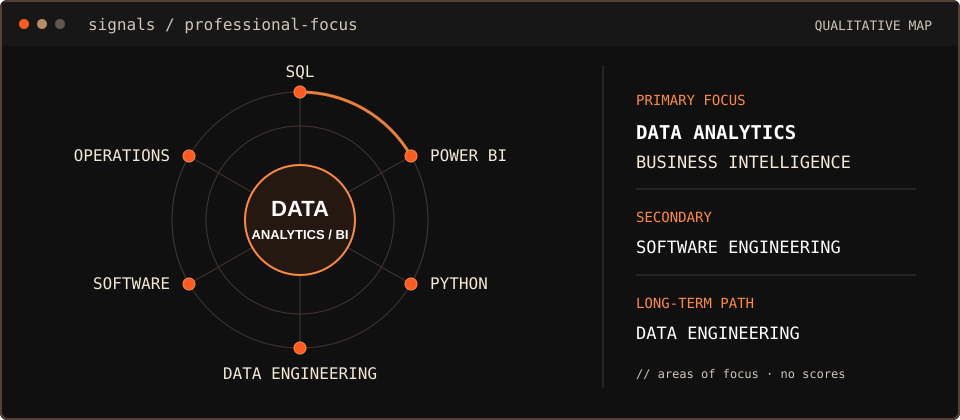

<picture>
  <source media="(prefers-color-scheme: dark)" srcset="assets/editor-hero-dark.svg">
  <source media="(prefers-color-scheme: light)" srcset="assets/editor-hero-light.svg">
  
</picture>

  <picture>
    <source media="(prefers-color-scheme: dark)" srcset="assets/typing-focus-dark.svg">
    <source media="(prefers-color-scheme: light)" srcset="assets/typing-focus-light.svg">
    
  </picture>
   
  

  
  
  
  
  

## `$ whoami`

I am a **Systems Engineering student** interested in turning operational information into useful business insight. My industrial context helps me think about processes, quality and bottlenecks before choosing a technical solution. I use software engineering to understand the full journey from data and databases to applications and testing.

## `$ trace --from operations --to decisions`

**Understand the process → structure the data → analyze the question → communicate the insight.**

## `$ cat tech-stack.yaml`

<table>
<tr>
<td width="50%" valign="top"><code>├─ data_analytics:</code>  SQL · Python · Pandas · Excel</td>
<td width="50%" valign="top"><code>├─ business_intelligence:</code>  Power BI · Excel · Data modeling</td>
</tr>
<tr>
<td valign="top"><code>├─ data_engineering:</code>  PostgreSQL · PySpark · ETL foundations</td>
<td valign="top"><code>╰─ software_engineering:</code>  Java · Spring Boot · React · TypeScript · Docker · Git</td>
</tr>
</table>

## `$ ls featured-projects/`

**[SmartFleet V2](https://github.com/juanj983009-eng/SMARTFLEET_V2)** · A vehicle telemetry platform combining live monitoring, operational thresholds and incident records.  
`Python` · `FastAPI` · `PostgreSQL` · `MongoDB` · `React`

**[Meca-PRO MES](https://github.com/juanj983009-eng/Mecapro-mes-V1)** · A manufacturing execution system for tracking production times, downtime and machining operations.  
`Java` · `Spring Boot` · `PostgreSQL` · `React` · `Docker`

**[TurnoShift](https://github.com/juanj983009-eng/TurnoShift)** · A workforce scheduling application with SQL Server persistence, Flyway migrations and Testcontainers integration tests.  
`Java` · `Spring Boot` · `SQL Server` · `React` · `TypeScript`

## `$ inspect engineering-principles`

Read the principles in text

- **Problem first:** Understand the operation and business question before choosing tools.
- **Data integrity:** Use clear models, traceability and consistent persistence.
- **Testing:** Check behavior with evidence and protect against regressions.
- **Security by Design:** Consider secrets, access and input validation throughout development.
- **Maintainability:** Favor clear systems and document relevant decisions.

## `$ inspect professional-focus`

Qualitative focus map; the positions do not represent skill scores.

**Current focus:** advanced SQL, Power BI, Python for analytics and ETL foundations. I am building toward Data Analyst and BI roles, with Data Engineering as a longer-term path.

## `$ cat learning.log`

- **IBM** — Python for Data Science, AI & Development
- **IBM** — Introduction to Data Engineering
- **Cisco Networking Academy** — Introduction to Cybersecurity

## `$ github --public-snapshot`

Counts reflect public, owned, non-fork repositories. Languages are counted by GitHub’s primary language per repository; they are not skill ratings. Updated weekly by GitHub Actions.

## `$ connect`

Open to opportunities where data, technology and real business problems meet.

  
