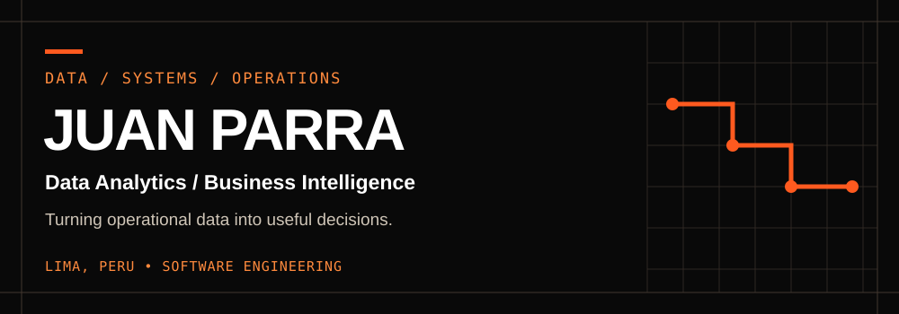
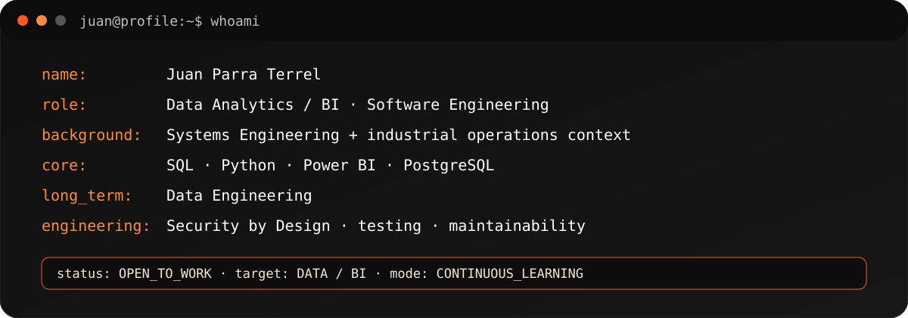
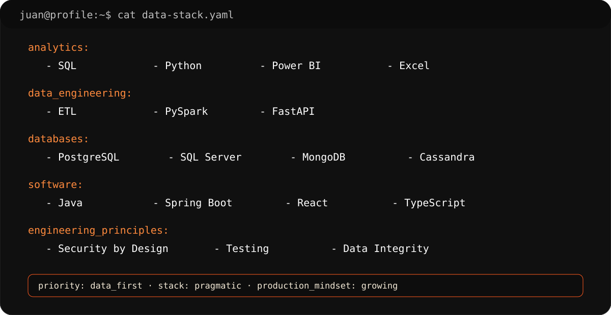
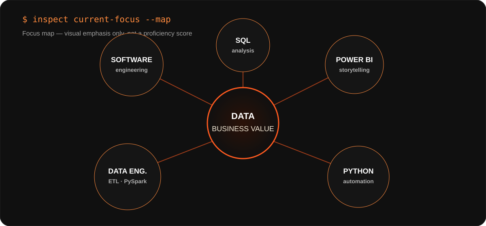

<div align="center">

<a href="https://github.com/juanj983009-eng">
  <picture>
    <source media="(prefers-color-scheme: dark)" srcset="assets/banner-dark.svg">
    <source media="(prefers-color-scheme: light)" srcset="assets/banner-light.svg">
    
  </picture>
</a>

<br/>


<br/>

<a href="https://www.linkedin.com/in/juan-jos%C3%A9-parra-terrel-96a435364/"></a>
<a href="https://portfolio-jp-eight-psi.vercel.app"></a>
<a href="mailto:juan983009@gmail.com"></a>

<br/><br/>


</div>

---

## `$ whoami`

<p align="center">
  
</p>

I am a **Systems Engineering student** focused on **Data Analytics, Business Intelligence and software development**.

My main interest is turning operational information into useful insights through **SQL, Python, Power BI and data modeling**, while using software engineering to understand the complete lifecycle of a solution: data, backend, frontend, databases, testing and deployment.

My industrial background gives me additional context for understanding **processes, operations, quality, bottlenecks and business problems** before choosing a technical solution.

---

## `$ cat data-stack.yaml`

<p align="center">
  
</p>

<div align="center">


<br/><br/>


</div>

---

## `$ inspect current-focus --map`

<p align="center">
  
</p>

> The map above represents **current professional emphasis**, not a numerical proficiency score.

**Primary target:** Data Analytics / BI  
**Long-term path:** Data Engineering  
**Secondary strength:** Software Engineering

---

## `$ ls featured-projects/`

<p align="center">
  
</p>

<table>
<tr>
<td width="33%" valign="top">

### [SMARTFLEET V2](https://github.com/juanj983009-eng/SMARTFLEET_V2)

Real-time telematics and operational analytics platform.

`Python` `FastAPI` `PostgreSQL` `MongoDB` `Cassandra` `React` `Docker`

</td>
<td width="33%" valign="top">

### [MECA-PRO MES](https://github.com/juanj983009-eng/Mecapro-mes-V1)

Manufacturing Execution System designed around machining-plant operations.

`Java` `Spring Boot` `PostgreSQL` `React` `Docker` `Nginx`

</td>
<td width="33%" valign="top">

### [TURNOSHIFT](https://github.com/juanj983009-eng/TurnoShift)

Workforce scheduling SaaS with relational persistence and integration testing.

`Java` `Spring Boot` `SQL Server` `React` `TypeScript` `Testcontainers`

</td>
</tr>
</table>

---

## `$ inspect engineering-principles`

```text
problem_first        = understand the business problem before choosing technology
data_integrity       = explicit models, traceability and consistent persistence
security_by_design   = security is part of architecture, not a final checklist
testing              = evidence before claims
maintainability      = prefer clear systems over unnecessary complexity
documentation        = record relevant technical decisions
```

### Security by Design

For active software projects I maintain a security-oriented engineering process covering, when applicable:

`secrets` · `authentication` · `authorization` · `sessions` · `RLS / tenant isolation` · `input validation` · `XSS / CSRF` · `rate limiting` · `HTTPS` · `dependencies` · `backups` · `logging` · `safe error handling`

> A control is not considered verified without technical evidence or tests.

---

## `$ cat current-focus.json`

```json
{
  "career_target": ["Data Analyst", "BI Analyst", "Data / Reporting roles"],
  "learning_now": ["Advanced SQL", "Power BI", "Python for analytics", "ETL foundations"],
  "building": ["Meca-PRO MES", "TurnoShift", "Data portfolio projects"],
  "long_term": "Data Engineering",
  "open_to_work": true
}
```

---

## `$ cat certifications.txt`

- **IBM** — Python for Data Science, AI & Development
- **IBM** — Introduction to Data Engineering
- **Cisco Networking Academy** — Introduction to Cybersecurity
- Continuous study in **SQL, Python, Power BI, ETL and software engineering**

---

## `$ github --activity`

<div align="center">


</div>

<p align="center"><sub>Repository language distribution is not a proficiency score.</sub></p>

---

## `$ connect --open-to-work`

<div align="center">

**Open to opportunities where data, technology and real business problems meet.**

<br/><br/>

<a href="https://www.linkedin.com/in/juan-jos%C3%A9-parra-terrel-96a435364/"></a>
<a href="https://portfolio-jp-eight-psi.vercel.app"></a>
<a href="mailto:juan983009@gmail.com"></a>

<br/><br/>

`Lima, Peru` · `Data Analytics` · `Business Intelligence` · `Software Engineering`

</div>
