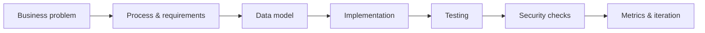

About me
I am a Systems Engineering student focused on Data Analytics, Business Intelligence and software development.

My main interest is turning raw operational information into useful insights through SQL, Python, Power BI and data modeling, while using my software engineering background to understand the complete lifecycle of a solution: data, backend, frontend, databases, testing and deployment.

I also bring practical context from industrial and manufacturing environments, which helps me approach technology from a business and process perspective rather than treating data as an isolated technical problem.
Current focus
├── Data Analytics      → SQL · Python · Power BI · Excel
├── Data Engineering    → ETL · PySpark · PostgreSQL · MongoDB · Cassandra
├── Software            → Java · Spring Boot · React · TypeScript
└── Engineering         → Git · Docker · Testing · Security by Design
Career goal: start and grow professionally in Data Analytics / BI, with a long-term path toward Data Engineering.

Featured projects
<table>
<tr>
<td width="50%" valign="top">🚚 SMARTFLEET V2
Fleet Telemetry & Operational Analytics

Real-time telematics platform for fleet monitoring, operational-risk assessment and incident auditing.

Highlights
- Reactive telemetry ingestion with FastAPI
- PostgreSQL for relational master data
- MongoDB for incident and audit records
- Cassandra-backed telemetry history
- Real-time streaming through SSE
- Operational rules and anomaly classification
- Docker Compose orchestration
Stack

Python FastAPI PostgreSQL MongoDB Cassandra React Docker
</td>
<td width="50%" valign="top">🏭 MECA-PRO MES
Manufacturing Execution System

MES/HMI solution designed around machining-plant operations, production tracking, downtime, inventory requests and operational data.

Highlights
- Java 17 + Spring Boot REST API
- PostgreSQL persistence with Flyway
- React HMI frontend
- JWT-based authentication
- Production and downtime tracking
- Dockerized development environment
- Security and performance hardening work
Stack

Java Spring Boot PostgreSQL React Docker Nginx
</td>
</tr><tr>
<td width="50%" valign="top">🗓️ TURNOSHIFT
Workforce Scheduling SaaS

Web application for planning employee shifts, schedules and exchanges for small and medium-sized organizations.

Highlights
- Spring Boot 4 + Java 21 backend
- SQL Server 2022
- React 19 + TypeScript + Vite
- Flyway migrations
- Testcontainers integration tests
- Verified integration-test suite
- Development rules and technical documentation
Stack

Java Spring Boot SQL Server React TypeScript Docker
</td>
<td width="50%" valign="top">🌐 PORTFOLIO
Selected Data & Software Work

Personal portfolio where I present selected projects, technical work and the problems behind each solution.

What you'll find
- Data-oriented projects
- Software engineering projects
- Project case studies
- Technologies and technical decisions
- Links to repositories and demos
</td>
</tr>
</table>Data & BI toolkit

What I work with
Area	Tools / concepts
Analysis	SQL, Python, Pandas, NumPy, Excel
BI & Visualization	Power BI, Plotly, Streamlit, KPIs, dashboards
Data Engineering	ETL, PySpark, relational and document databases
Databases	PostgreSQL, SQL Server, MongoDB, Cassandra
Data Modeling	Relational modeling, normalization, integrity, analytical structures

Software engineering stack

Layer	Technologies
Backend	Java, Spring Boot, Node.js, Python
Frontend	React, Next.js, TypeScript, JavaScript
Persistence	PostgreSQL, SQL Server, MongoDB
Engineering	Git, GitHub, Docker, REST APIs, testing
Principles	Security by Design, maintainability, data integrity, responsive UX

How I approach projects
I try to build projects as systems, not only as interfaces or isolated code exercises.

Engineering priorities
- Understand the business problem before choosing technology
- Keep data models explicit and traceable
- Validate assumptions with tests and evidence
- Apply Security by Design, not security as an afterthought
- Document relevant technical decisions
- Prefer maintainable solutions over unnecessary complexity
Currently working on
<table>
<tr>
<td>Data
- Strengthening advanced SQL
- Building practical analytics projects
- Improving Power BI and data storytelling
- Expanding ETL / Data Engineering foundations
</td>
<td>Software
- Evolving Meca-PRO MES
- Improving TurnoShift
- Building production-oriented engineering habits
- Applying security checklists to active projects
</td>
</tr>
</table>Certifications & continuous learning
- IBM — Python for Data Science, AI & Development
- IBM — Introduction to Data Engineering
- Cisco Networking Academy — Introduction to Cybersecurity
- Continuous study in SQL, Python, Power BI, ETL and software engineering
GitHub activity

Language statistics describe repository composition, not proficiency.

Let's connect

Open to opportunities in Data Analytics, BI and technology roles where data and software solve real business problems.

<!--
**juanj983009-eng/juanj983009-eng** is a ✨ _special_ ✨ repository because its `README.md` (this file) appears on your GitHub profile.

Here are some ideas to get you started:

- 🔭 I’m currently working on ...
- 🌱 I’m currently learning ...
- 👯 I’m looking to collaborate on ...
- 🤔 I’m looking for help with ...
- 💬 Ask me about ...
- 📫 How to reach me: ...
- 😄 Pronouns: ...
- ⚡ Fun fact: ...
-->
