<picture>
  <source media="(prefers-color-scheme: dark)" srcset="assets/editor-hero-dark-v3.svg">
  <source media="(prefers-color-scheme: light)" srcset="assets/editor-hero-light-v3.svg">
  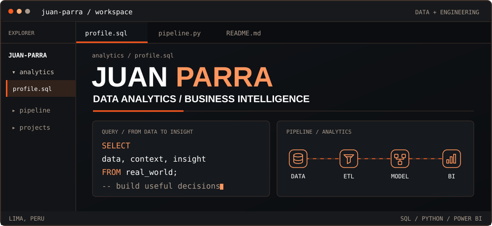
</picture>

  <picture>
    <source media="(prefers-color-scheme: dark)" srcset="assets/typing-focus-dark.svg">
    <source media="(prefers-color-scheme: light)" srcset="assets/typing-focus-light.svg">
    
  </picture>
   
  

  
  
  
  
  

## `$ whoami`


**Systems Engineering student focused on Data Analytics and Business Intelligence.** I use my industrial operations perspective to understand processes, identify bottlenecks and turn data into useful insights. I also build software to connect data, applications and business needs.

More about my approach

I start by understanding the operation and the business question before choosing tools. I am strengthening my skills in SQL, Power BI, Python and data engineering foundations while exploring how databases, applications and testing fit together.

## `$ trace --from operations --to decisions`

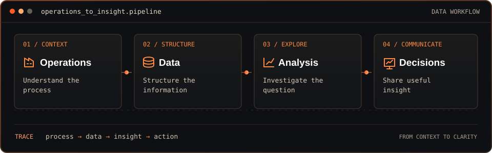

Read the workflow in text

Understand the process → structure the data → analyze the question → communicate the insight.

## `$ cat tech-stack.yaml`

<table>
<tr>
<td width="50%">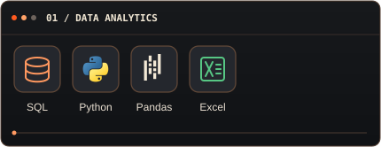</td>
<td width="50%">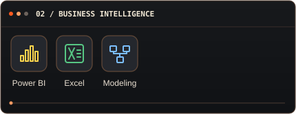</td>
</tr>
<tr>
<td width="50%">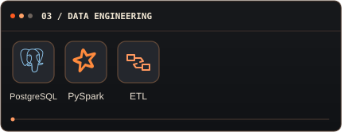</td>
<td width="50%">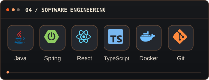</td>
</tr>
</table>

View the stack in text

- **Data Analytics:** SQL, Python, Pandas, Excel
- **Business Intelligence:** Power BI, Excel, data modeling
- **Data Engineering:** PostgreSQL, PySpark, ETL foundations
- **Software Engineering:** Java, Spring Boot, React, TypeScript, Docker, Git

## `$ ls featured-projects/`

[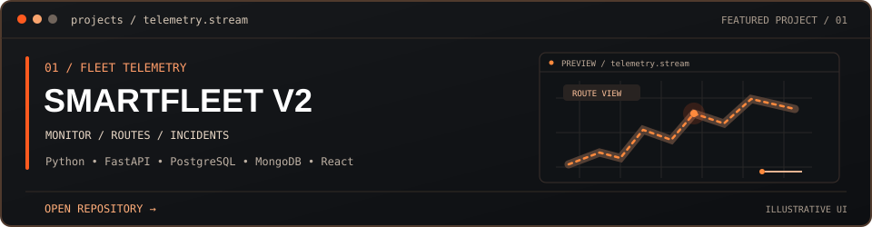](https://github.com/juanj983009-eng/SMARTFLEET_V2)

**[SmartFleet V2](https://github.com/juanj983009-eng/SMARTFLEET_V2)** · A vehicle telemetry platform combining live monitoring, operational thresholds and incident records.  
`Python` · `FastAPI` · `PostgreSQL` · `MongoDB` · `React`

[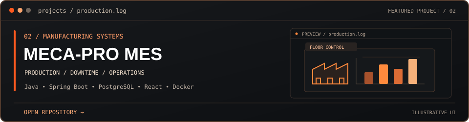](https://github.com/juanj983009-eng/Mecapro-mes-V1)

**[Meca-PRO MES](https://github.com/juanj983009-eng/Mecapro-mes-V1)** · A manufacturing execution system for tracking production times, downtime and machining operations.  
`Java` · `Spring Boot` · `PostgreSQL` · `React` · `Docker`

[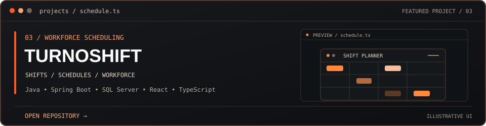](https://github.com/juanj983009-eng/TurnoShift)

**[TurnoShift](https://github.com/juanj983009-eng/TurnoShift)** · A workforce scheduling application with SQL Server persistence, Flyway migrations and Testcontainers integration tests.  
`Java` · `Spring Boot` · `SQL Server` · `React` · `TypeScript`

## `$ inspect engineering-principles`

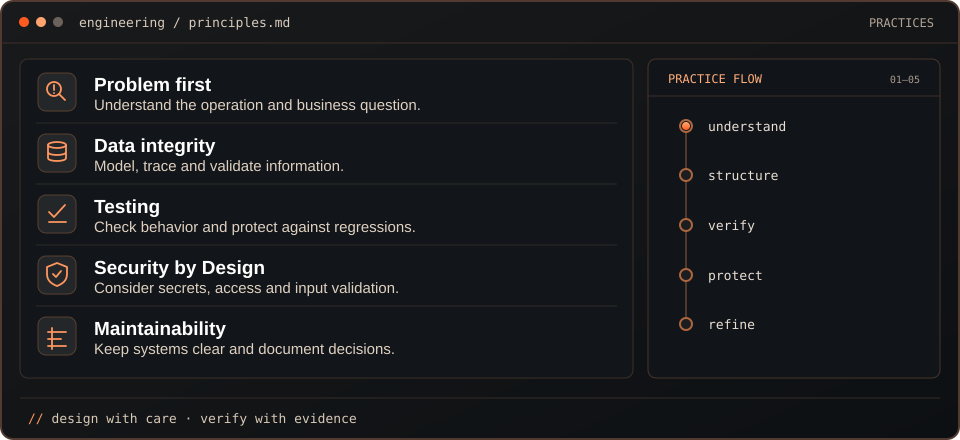

Read the principles in text

- **Problem first:** Understand the operation and business question before choosing tools.
- **Data integrity:** Use clear models, traceability and consistent persistence.
- **Testing:** Check behavior with evidence and protect against regressions.
- **Security by Design:** Consider secrets, access and input validation throughout development.
- **Maintainability:** Favor clear systems and document relevant decisions.

## `$ inspect professional-focus`


Qualitative focus map; the positions do not represent skill scores.

**Current focus:** advanced SQL, Power BI, Python for analytics and ETL foundations. I am building toward Data Analyst and BI roles, with Data Engineering as a longer-term path.

## `$ cat learning.log`

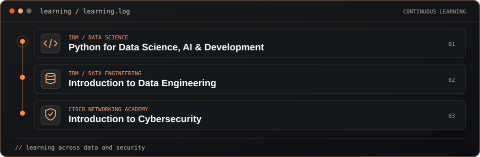

Read the learning log in text

- **IBM** — Python for Data Science, AI & Development
- **IBM** — Introduction to Data Engineering
- **Cisco Networking Academy** — Introduction to Cybersecurity

## `$ github --public-snapshot`

Counts reflect public, owned, non-fork repositories. Languages are counted by GitHub’s primary language per repository; they are not skill ratings. Updated weekly by GitHub Actions.

## `$ connect`

Open to opportunities where data, technology and real business problems meet.

  
