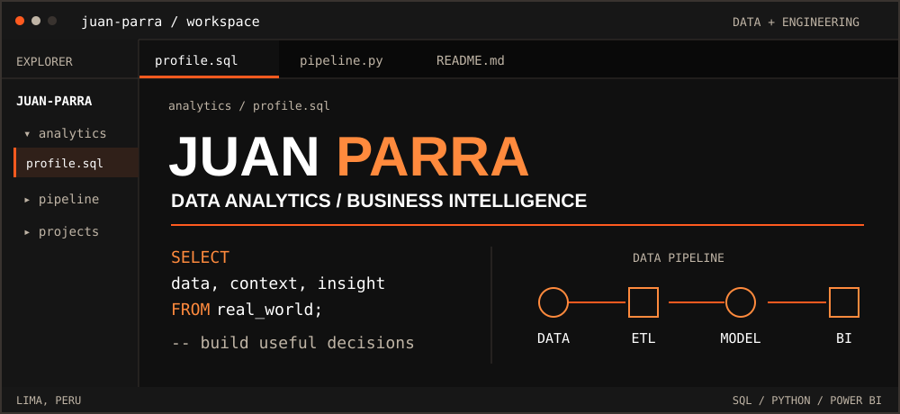
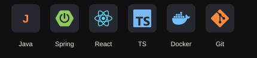
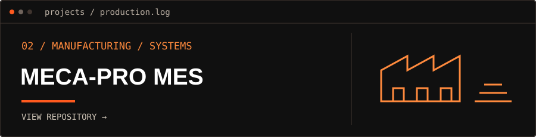
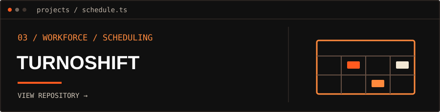
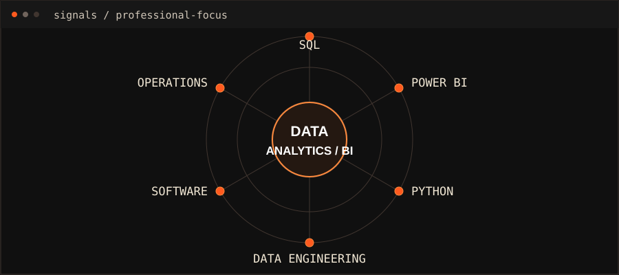
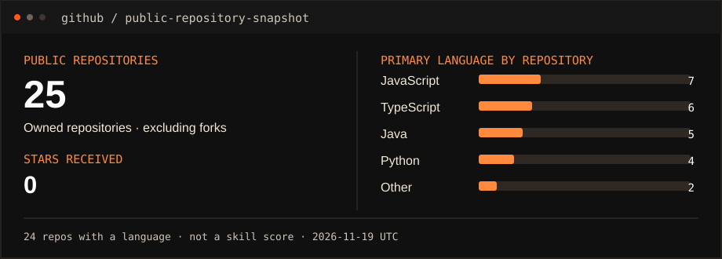

<picture>
  <source media="(prefers-color-scheme: dark)" srcset="assets/editor-hero-dark.svg">
  <source media="(prefers-color-scheme: light)" srcset="assets/editor-hero-light.svg">
  
</picture>

## `$ whoami`

```text
juan@profile:~$ whoami

  name:     Juan Parra Terrel
  focus:    Data Analytics / BI
  studies:  Systems Engineering
  context:  Industrial operations
  also:     Software Engineering
  location: Lima, Peru
```

I am a **Systems Engineering student** interested in turning operational information into useful business insight. My industrial context helps me think about processes, quality and bottlenecks before choosing a technical solution. I use software engineering to understand the full journey from data and databases to applications and testing.

## `$ trace --from operations --to decisions`


**Understand the process → structure the data → analyze the question → communicate the insight.**

This is how I connect operational context with analytics and software: start with the problem, make the data understandable and support decisions with evidence.

## `$ cat tech-stack.yaml`

<table>
<tr>
<td width="50%" valign="top"><code>├─ data_analytics:</code><br><br><sub>SQL · Python · Pandas · Excel</sub></td>
<td width="50%" valign="top"><code>├─ business_intelligence:</code><br><br><sub>Power BI · Excel · Data modeling</sub></td>
</tr>
<tr>
<td valign="top"><code>├─ data_engineering:</code><br><br><sub>PostgreSQL · PySpark · ETL foundations</sub></td>
<td valign="top"><code>╰─ software_engineering:</code><br><br><sub>Java · Spring Boot · React · TypeScript · Docker · Git</sub></td>
</tr>
</table>

## `$ ls featured-projects/`

[](https://github.com/juanj983009-eng/SMARTFLEET_V2)

**[SmartFleet V2](https://github.com/juanj983009-eng/SMARTFLEET_V2)** · Vehicle telemetry and operational monitoring, connecting a FastAPI backend to a React interface.  
`Python` · `FastAPI` · `PostgreSQL` · `MongoDB` · `React`

[](https://github.com/juanj983009-eng/Mecapro-mes-V1)

**[Meca-PRO MES](https://github.com/juanj983009-eng/Mecapro-mes-V1)** · Manufacturing execution and shop-floor monitoring for machining operations.  
`Java` · `Spring Boot` · `PostgreSQL` · `React` · `Docker`

[](https://github.com/juanj983009-eng/TurnoShift)

**[TurnoShift](https://github.com/juanj983009-eng/TurnoShift)** · Workforce scheduling with relational persistence and integration tests.  
`Java` · `Spring Boot` · `SQL Server` · `React` · `TypeScript`

## `$ inspect engineering-principles`

| Principle | In practice |
| :--- | :--- |
| **Problem first** | Understand the operation and business question before choosing tools. |
| **Data integrity** | Use clear models, traceability and consistent persistence. |
| **Testing** | Check behavior with evidence and protect against regressions. |
| **Security by Design** | Consider secrets, access and input validation throughout development. |
| **Maintainability** | Favor clear systems and document relevant decisions. |

## `$ inspect professional-focus`



<sub>Qualitative focus map; the positions do not represent skill scores.</sub>

**Current focus:** advanced SQL, Power BI, Python for analytics and ETL foundations. I am building toward Data Analyst and BI roles, with Data Engineering as a longer-term path.

**Training:** IBM — Python for Data Science, AI & Development · IBM — Introduction to Data Engineering · Cisco Networking Academy — Introduction to Cybersecurity.

## `$ github --public-snapshot`



<sub>Counts reflect public, owned, non-fork repositories. Languages are counted by GitHub’s primary language per repository; they are not skill ratings. Updated weekly by GitHub Actions.</sub>

## `$ connect`

Open to opportunities where data, technology and real business problems meet.

[LinkedIn](https://www.linkedin.com/in/juan-jos%C3%A9-parra-terrel-96a435364/) &nbsp; / &nbsp; [Portfolio](https://portfolio-jp-eight-psi.vercel.app) &nbsp; / &nbsp; [Email](mailto:juan983009@gmail.com)
